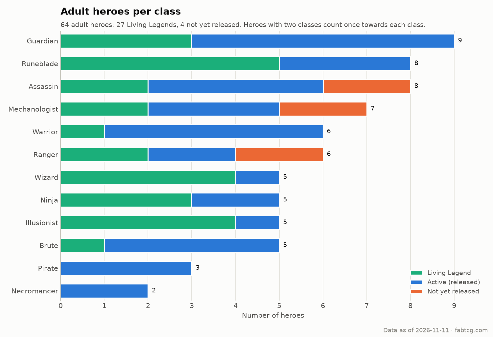
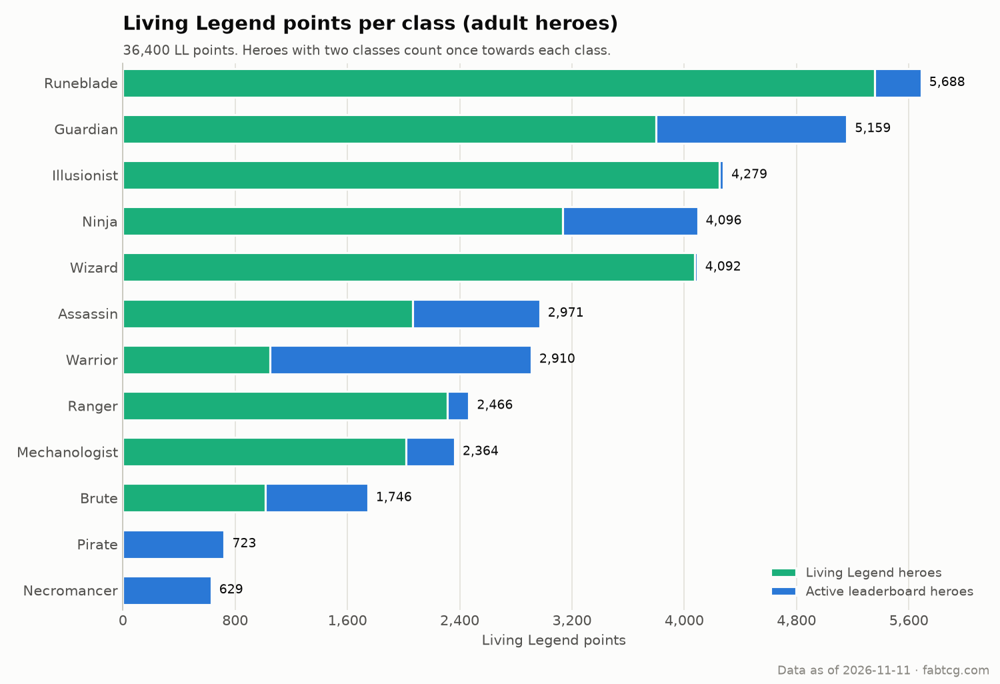

# Flesh and Blood: Living Legend points per class

Weekly charts of the adult Flesh and Blood heroes and their Living Legend (LL)
points, grouped by hero class. A GitHub Action updates the charts, the CSV files
and the table below every Monday.

## Adult heroes per class



## Living Legend points per class



## Class summary

The same numbers as the charts. The full data is in
[`data/class_summary.csv`](data/class_summary.csv) (one row per class) and
[`data/heroes.csv`](data/heroes.csv) (one row per hero).

<!-- class-summary:start -->
_Data as of 2026-11-11._

| Class | LL heroes | Active heroes | Not yet released | Total heroes | LL points (LL heroes) | LL points (active heroes) | Total LL points |
|---|---:|---:|---:|---:|---:|---:|---:|
| Runeblade | 5 | 3 | 0 | 8 | 5,356 | 332 | 5,688 |
| Guardian | 3 | 6 | 0 | 9 | 3,801 | 1,358 | 5,159 |
| Illusionist | 4 | 1 | 0 | 5 | 4,250 | 29 | 4,279 |
| Ninja | 3 | 2 | 0 | 5 | 3,136 | 960 | 4,096 |
| Wizard | 4 | 1 | 0 | 5 | 4,072 | 20 | 4,092 |
| Assassin | 2 | 4 | 2 | 8 | 2,067 | 904 | 2,971 |
| Warrior | 1 | 5 | 0 | 6 | 1,048 | 1,862 | 2,910 |
| Ranger | 2 | 2 | 2 | 6 | 2,312 | 154 | 2,466 |
| Mechanologist | 2 | 3 | 2 | 7 | 2,017 | 347 | 2,364 |
| Brute | 1 | 4 | 0 | 5 | 1,014 | 732 | 1,746 |
| Pirate | 0 | 3 | 0 | 3 | 0 | 723 | 723 |
| Necromancer | 0 | 2 | 0 | 2 | 0 | 629 | 629 |
<!-- class-summary:end -->

## How the data is built

- **Heroes, classes and talents** come from the API behind
  [fabtcg.com/hero-selection](https://fabtcg.com/hero-selection/). This includes
  heroes that are announced but not yet released.
- **LL points** come from the "Living Legend Leaderboard" and "Living Legend
  Heroes" tables on [fabtcg.com/living-legend](https://fabtcg.com/living-legend/).
- **Adult heroes only.** Young-only heroes are left out. So are alternate forms
  that are legal in neither Classic Constructed nor Living Legend (for example
  Mortimer, Living Virus).
- **Dual-class heroes** (for example Pirate Necromancer) count once towards each
  of their classes, for both hero counts and LL points.
- **Talents** (Draconic, Elemental, Chaos, ...) are not classes: Fai, Rising
  Rebellion is a Draconic Ninja and counts as a Ninja.

## Run it locally

The script declares its dependencies inline, so [uv](https://docs.astral.sh/uv/)
is the only requirement:

```bash
uv run fab_class_charts.py --readme README.md
```

This writes the charts to `charts/`, the CSV files to `data/`, and the summary
table into this README.
